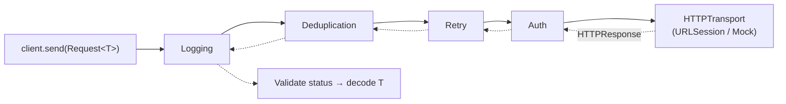

# Courier

[](https://github.com/DeepakPal25/Courier/actions/workflows/ci.yml)


**A small, composable HTTP client built for Swift 6 strict concurrency.**

Courier is the networking layer most production iOS apps end up writing by hand: typed requests, retries with backoff, token refresh that doesn't stampede, request de-duplication, redacted logging, and a mock transport for tests. It has zero dependencies and is fully `Sendable`.

```swift
let client = HTTPClient(
    baseURL: URL(string: "https://api.example.com/v1")!,
    middleware: [
        LoggingMiddleware(),
        DeduplicationMiddleware(),
        RetryMiddleware(policy: .default),
        AuthMiddleware(tokens: tokenRefresher),
    ]
)

let user = try await client.send(Request<User>.get("users/42"))
```

## Features

| | |
|---|---|
| **Typed requests** | `Request<User>` carries its response type, so you can't decode into the wrong model. |
| **Middleware pipeline** | Every cross-cutting concern is a `Middleware`. Add, remove or reorder them; write your own in a few lines. |
| **Retries** | Exponential backoff with full jitter, `Retry-After` support, idempotent methods only by default, cancellation-aware. |
| **Token refresh** | An actor guarantees one refresh at a time, no matter how many requests get `401` at once. |
| **De-duplication** | Ten SwiftUI views asking for the same `GET` at once produce one network call. |
| **Logging** | Pluggable sink (`os.Logger`, crash reporter…), with `Authorization` and cookies redacted. |
| **Testability** | `CourierTesting` ships `MockTransport` for fast, deterministic, network-free tests. |
| **Swift 6 native** | Strict concurrency, no `@unchecked Sendable` in the library, no Combine, no completion handlers. |

## Installation

Add Courier with Swift Package Manager:

```swift
dependencies: [
    .package(url: "https://github.com/DeepakPal25/Courier.git", from: "1.0.0"),
],
targets: [
    .target(name: "App", dependencies: ["Courier"]),
    .testTarget(name: "AppTests", dependencies: ["Courier", .product(name: "CourierTesting", package: "Courier")]),
]
```

Or in Xcode: **File → Add Package Dependencies…** and paste the repository URL.

## Usage

### Requests

```swift
// GET with query parameters
let results = try await client.send(
    Request<[Repo]>.get("search/repos", query: [URLQueryItem(name: "q", value: "swift")])
)

// POST / PUT / PATCH a JSON body
let created: User = try await client.send(.post("users", json: NewUser(name: "Ada")))

// Endpoints with no response body
try await client.send(Request<EmptyResponse>.delete("users/42"))

// Full control
let request = Request<Report>(.get, "reports/q3", headers: ["Accept-Language": "en"], timeout: .seconds(30))
```

A nice pattern is to group endpoints in an extension so call sites read like an API:

```swift
extension Request where Response == User {
    static func user(id: Int) -> Self { .get("users/\(id)") }
}

let user = try await client.send(.user(id: 42))
```

### Token refresh

```swift
let tokens = TokenRefresher(initialToken: keychain.accessToken) {
    let fresh = try await authService.refresh(using: keychain.refreshToken)
    keychain.accessToken = fresh.accessToken
    return fresh.accessToken
}

let client = HTTPClient(baseURL: apiURL, middleware: [AuthMiddleware(tokens: tokens)])
```

If eight requests receive `401` at once, `refresh` runs **once**; the other seven wait for it and replay with the new token. A request that still gets `401` after refreshing fails instead of looping.

### Retries

```swift
RetryMiddleware(policy: RetryPolicy(
    maxAttempts: 4,
    backoff: .exponential(base: .milliseconds(250), maxDelay: .seconds(8)),
    retryableStatusCodes: [429, 503]
))
```

POST and PATCH are not retried unless you opt in through `retryableMethods`, so a flaky connection can't create duplicate orders.

### Logging

```swift
import OSLog

let logger = Logger(subsystem: "com.example.app", category: "network")
LoggingMiddleware(logsHeaders: true) { logger.debug("\($0, privacy: .public)") }
```

```
→ GET https://api.example.com/v1/users/42
   Authorization: <redacted>
← 200 GET https://api.example.com/v1/users/42 (184 ms, 312 bytes)
```

### Writing middleware

```swift
struct AppVersionHeader: Middleware {
    func intercept(_ request: URLRequest, next: HTTPHandler) async throws -> HTTPResponse {
        var request = request
        request.setValue(Bundle.main.appVersion, forHTTPHeaderField: "X-App-Version")
        return try await next(request)
    }
}
```

Or inline with `ClosureMiddleware { request, next in … }`.

### Testing your app's networking

```swift
import CourierTesting
import Testing

@Test func showsProfile() async throws {
    let transport = MockTransport()
    await transport.enqueue(try .json(User(id: 1, name: "Ada")))

    let model = ProfileModel(client: HTTPClient(baseURL: testURL, transport: transport))
    await model.load()

    #expect(model.name == "Ada")
    #expect(await transport.requests.first?.url?.path() == "/users/1")
}
```

## Architecture



Each middleware receives the request and a `next` handler for the rest of the chain. The first middleware in the array is the outermost layer.

## Design decisions

These are the trade-offs behind the API, written down so reviewers and contributors can challenge them.

- **Value types across the chain.** The transport converts `HTTPURLResponse` into the `HTTPResponse` struct immediately. Everything above the transport handles plain `Sendable` values, which is what lets the library compile under Swift 6 without `@unchecked Sendable`.
- **Actors only where there is shared mutable state.** `TokenRefresher` and `DeduplicationMiddleware` own mutable dictionaries and in-flight tasks, so they are actors. Everything else is an immutable struct.
- **Actor reentrancy is handled deliberately.** Refreshes and de-duplicated requests are stored as `Task`s before the first `await`, so callers that enter the actor while it is suspended join the existing work instead of starting a duplicate.
- **Middleware rather than a configuration object.** A config struct with `retryCount`, `authToken`, `logLevel`… grows forever. A pipeline keeps each concern isolated and independently testable, and lets apps add their own.
- **Retries are opt-in for non-idempotent methods.** Correctness beats convenience.
- **Injected clocks and sinks.** `RetryMiddleware` takes a `sleep` closure and `LoggingMiddleware` a log closure, so tests run in milliseconds with exact assertions on backoff delays.
- **No dependencies.** A networking layer sits under every feature of an app. It shouldn't pull a dependency graph in with it.

## Requirements

- Swift 6.0+ / Xcode 16+
- iOS 16+, macOS 13+, tvOS 16+, watchOS 9+, visionOS 1+

## Roadmap

- [ ] Multipart form uploads
- [ ] Upload/download progress as `AsyncStream`
- [ ] Response caching middleware (ETag / `If-None-Match`)
- [ ] Circuit breaker middleware
- [ ] Linux support via `FoundationNetworking`

Contributions are welcome. See [CONTRIBUTING.md](CONTRIBUTING.md).

## License

Courier is available under the MIT license. See [LICENSE](LICENSE).
